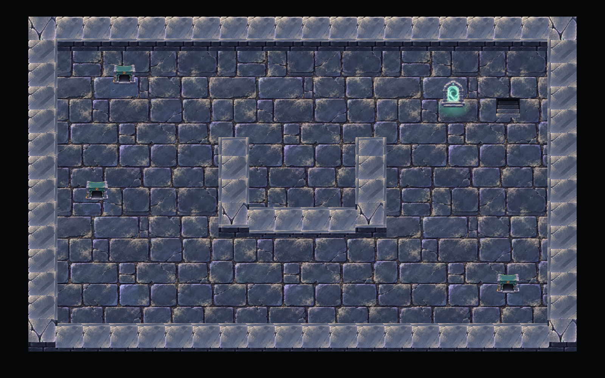
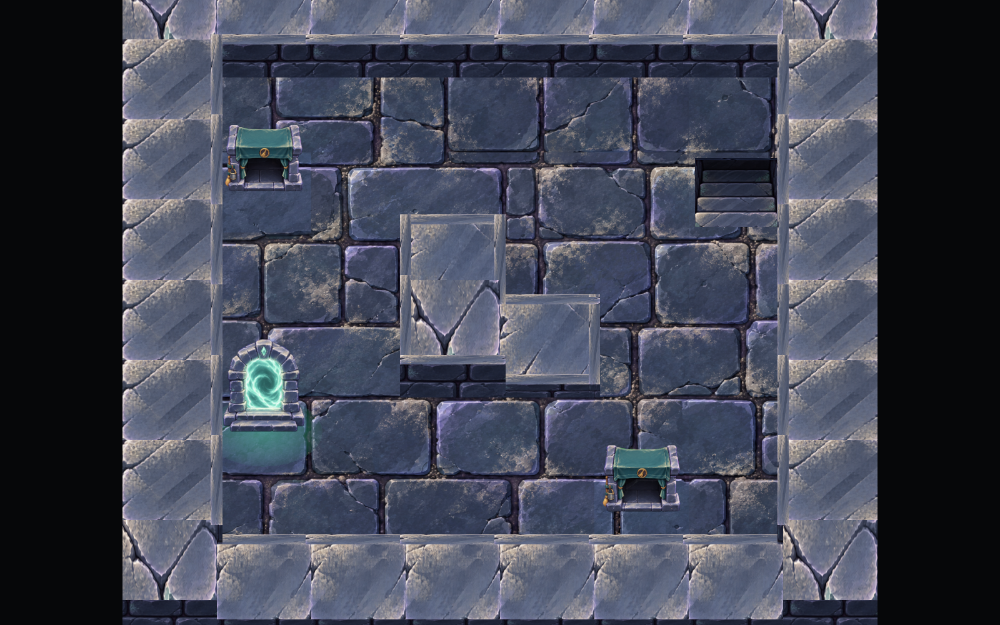

# 던전 내부 원화

2026-10-26 적용. `GameAsset`의 `DungeonInterior_01`~`11` PNG를 `Assets/Art/DungeonInterior`에 원본 그대로 보관합니다. 참고 이미지의 석재 바닥·밝은 벽 상판·어두운 벽돌 면·초록 포탈·청소부 은신처·계단을 현재 2.5D 던전에 연결했습니다.





실제 방과 통로의 형태는 제작 도구에서 만든 도면에 따릅니다. 기존 던전과 저장 도면에도 같은 원화 규칙을 적용합니다. 벽·통행·몬스터와 시체의 스폰·계단/은신/탈출 판정, 저장 형식은 유지합니다.

## 설정 위치

`Assets/Resources/DungeonInteriorArt.asset`에서 변경합니다. 씬을 다시 구성할 때 적용하므로 Play를 종료하고 설정을 바꾼 뒤 재입장하세요.

| 설정 | 용도 |
| --- | --- |
| Dusty Floor / Clean Floor | 일반 바닥·계단 주변 / 입구·은신처의 예약 칸 바닥 |
| Floor Repeat Cells | 바닥 원본 이미지 한 장이 반복되는 칸 수. 기본 6칸 |
| Horizontal / Vertical / Corner / Junction / End Top | 직선·세로·모서리·분기·끝 벽의 상판 석재 |
| Wall Face | 벽의 앞·옆면에 사용할 벽돌 영역 |
| Portal | 입구와 특수 탈출 포탈 원화 |
| Hideout Open / Closed | 사용 전·나온 뒤의 열린 은신처 / 은신 중 닫힌 커튼 |
| Stairs | 원화에서 솟은 외곽 테두리를 제외한 계단 내부 UV. 위층은 푸른 색조로 구별하며 실제 이동 방향은 기존 HUD와 미니맵에서 안내 |
| Portal / Hideout / Stair Width | 종류별 고정 월드 폭. 한 칸 통로의 벽 여유에 맞춰 최대 1.25이며 위치별 자동 축소는 없음 |

현재 **Portal Width 1.25 / Hideout Width 1.2 / Stair Width 1.25**입니다. 한 칸 1.45에서 양쪽 경계벽 폭 0.18과 여유 0.02를 제외한 1.25를 상한으로 사용해 벽 옆에서도 시설이 박혀 보이지 않도록 했습니다. 은신처는 추가 여유를 두며 열림·닫힘에 같은 크기를 적용합니다.

각 **UV**는 원본 PNG를 바꾸지 않고 사용할 부분을 지정합니다. 포탈·은신처·계단은 투명 여백을 제외합니다. 벽 PNG는 긴 직선·L·T 등 서로 다른 규모의 모듈이므로 상판과 벽돌 면을 나누어 사용하고, 실제 연결 모양은 도면의 벽 연결에 따라 구성합니다. 그림 전체를 벽 한 칸에 축소해 넣지 않습니다.

열림·닫힘 은신처는 같은 표시 영역과 발판을 사용합니다. 로드할 때 이미 은신 중이었다면 닫힌 원화를 적용하고, 나오면 열린 원화로 되돌립니다.

계단 칸에는 중앙 바닥을 비우고 주변 바닥과 같은 높이·무늬 좌표를 쓰는 테두리를 연결합니다. 그 안쪽 0.06 아래에 계단 내부 원화를 넣고 바닥에서 연결되는 짧은 내벽을 만듭니다. 계단은 정사각 도면 칸의 원근으로 표시하므로 외곽 프레임 PNG 전체의 화면 비율을 강제하지 않습니다. 계단 위 플레이어의 높이와 E 이동 판정은 기존 바닥 기준을 유지합니다.

초기 적용에서 사용하던 위치별 자동 축소는 제거했습니다. 포탈은 입구·출구가 같은 크기이며 위·아래 계단도 같은 크기입니다. 시설별 폭을 변경하면 해당 종류 전체에 적용됩니다. 세워진 은신처·포탈은 원화 비율을 유지하며, 계단은 바닥의 정사각 입구에 맞춰 표시합니다. 이 상한을 넘는 설정은 출시 사전 검사에서도 거부합니다.

## 표시와 성능

`ThreeDWorldView`가 현재 도면을 `DungeonInteriorRenderer`에 전달합니다. 바닥·벽은 실제 `DungeonLayoutFactory`의 충돌 중심과 크기에 맞춘 입체 표면입니다. 동서남북 벽 연결 16가지를 분류해 상판 원화를 선택합니다. 벽이 없는 빈 공간 가장자리의 경계도 같은 표시 규칙을 사용합니다.

바닥과 벽은 **16×16칸 및 원본 텍스처별 메시**로 합칩니다. 타일마다 렌더러나 재질을 생성하지 않습니다. 상판과 앞면이 같은 원본 텍스처를 사용하면 같은 배치에 들어갑니다. 방 크기가 큰 도면에서는 청크별로 카메라 컬링이 가능합니다. 포탈의 바닥 빛은 공유 재질의 평면 그라데이션이며 추가 실시간 광원을 만들지 않습니다.

원화에는 명암이 포함돼 있어 전용 Unlit 셰이더를 사용합니다. 던전별 시야·바깥 어둠은 기존 설정대로 적용됩니다. 질감이 지나치게 작아 보이면 Floor Repeat Cells를 늘리고, 최종 밝기는 실제 던전에서 시야 설정과 함께 확인하세요.

원본 텍스처는 CPU Read/Write를 끄고 mipmap을 사용합니다. 런타임 픽셀 읽기나 새 물리 충돌은 추가하지 않으며, 층 표시가 해제될 때 생성한 메시·재질을 해제합니다. 실제 Draw Calls와 FPS 변화는 플레이 중 Frame Debugger·Profiler 측정 대상입니다.

## 검증과 플레이 확인

분리된 Unity Editor에서 **336개 검사**를 통과했습니다. 원화 참조·UV, 벽 연결 16종, 64×64 도면의 배칭·재질 한도, 난수·도면 보존, 중복 충돌 없음, 커튼 상태와 자원 해제를 검사했습니다. 벽 옆/넓은 방의 고정 크기, 경계벽 사이의 시설 폭, 계단 중앙에 바닥이 남지 않는지, 테두리와 주변 바닥의 높이·UV가 연속인지, 계단 내부가 바닥 아래에서 한 칸 안에 들어가는지도 확인했습니다. DX11 에디터에서 같은 렌더러의 전체 화면과 벽 옆 배치를 정적으로 촬영했습니다. 컴파일 오류·경고와 검사 예외는 없었으며 Play 모드와 게임 빌드는 실행하지 않았습니다.

```powershell
./Tools/Validate-GameFlow.ps1 -EditorOnly -ValidationWorkspace '.utmp/q'
```

1. MainMenu → 마을 → 던전으로 들어가 바닥과 벽 상판·벽돌 면을 확인합니다.
2. 직선·모서리·분기 벽 가까이 걸어가고 대시하며 그림과 충돌을 확인합니다.
3. 은신처에서 E로 숨으면 커튼이 닫히고, 나오면 열리는지 확인합니다. 은신 중 저장·이어하기도 확인합니다.
4. 위·아래 계단의 표시와 이동, 입구·특수 포탈의 귀환을 확인합니다.
5. 여러 층과 서로 다른 도면, 한 칸 통로, 던전별 어둠 설정에서 확인합니다.

정적 화면은 화면 구성을 확인하기 위한 별도 도면입니다. 게임 내 시야·캐릭터·몬스터를 포함한 플레이 화면 검증과는 구분합니다.
