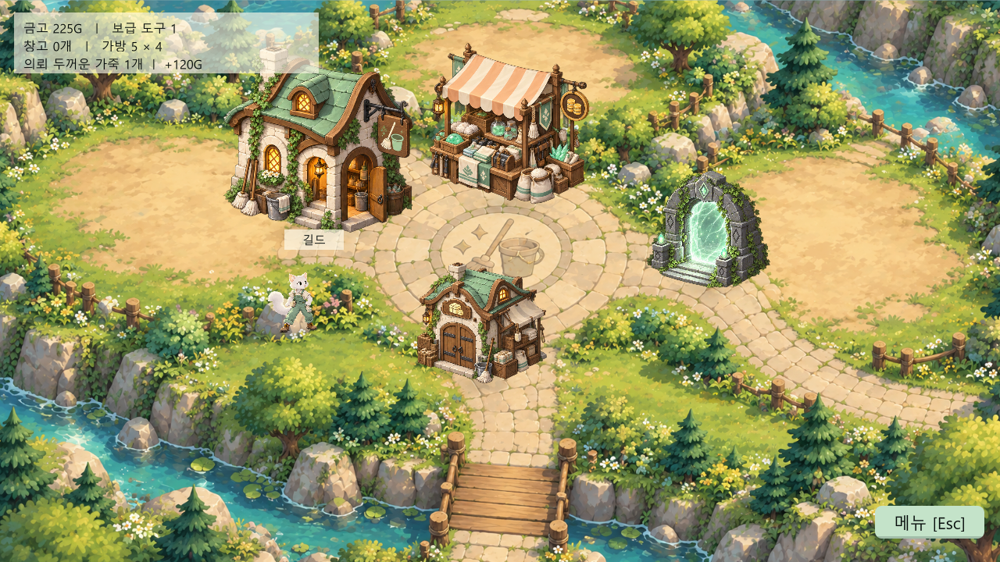

# Dungeon Sweeper

청소부 옷을 입은 하얀 고양이가 던전을 탐험하는 **비전투 전리품 회수 게임**입니다. 몬스터의 순찰과 추적을 피하면서 시체를 해체하고, 회수품을 제한된 가방에 배치해 살아서 마을로 돌아옵니다. 가져온 전리품은 직접 판매하거나 성장 재료로 사용합니다.

현재는 메인 메뉴부터 마을·던전·저장/불러오기까지 플레이할 수 있는 **개발 중인 프로토타입**입니다. 최종 이미지·영상·음악을 연결할 구조를 마련했으며, 콘텐츠와 출시 검증은 계속 진행 중입니다.

문서 기준: **2026-10-21** · 던전 선택·난이도 표시, 층별 설정 화면 통합, 던전·층별 보상 테이블, 미사용 코드 정리와 Windows DX11 고정을 반영했습니다.

고양이와 몬스터의 일러스트 애니메이션에 입체 바닥·벽과 그림자를 결합한 **2.5D 표시**를 사용합니다. 밝은 마을과 어두운 던전을 정사영 카메라로 보여 줍니다. 캐릭터 그림은 지면에 수직으로 세우고 화면상 비율을 보정해, 상체가 벽 메시와 교차하는 문제를 줄였습니다. [2.5D 구조와 편집](Docs/2_5D_PRESENTATION.md), [아트 적용 기록](Docs/ART_DIRECTION.md)을 참고하세요. Blender 3D 모델은 비교·재사용용 실험 원본으로 보관합니다.



| 항목 | 현재 기준 |
| --- | --- |
| 엔진 | Unity **6000.6.0f1** |
| 렌더링 / 입력 | Universal Render Pipeline / Input System |
| 대상 플랫폼 | Windows 64비트, 오프라인 싱글 플레이 |
| 시작 씬 | `MainMenu → Town → Dungeon` |
| 던전 입장 | 마을 입구에서 선택창 열기 → 난이도 확인 → 선택 던전 입장 |
| 던전 제작 | 수동 도면 편집 + 조건별 자동 생성·미리보기·채택 |
| 도면 범위 | 최대 16층, 층마다 가로·세로 각각 4~64칸 |
| 저장 | 자동 저장 1개 + 수동 저장 10개, 수동 슬롯 수 변경 가능 |

## 플레이 흐름

1. **마을에서 준비** — 길드에서 회수 의뢰를 받고 상점에서 해체 보급 도구를 구매합니다.
2. **던전 선택과 탐색** — 마을 입구에서 던전별 난이도를 확인하고 원하는 던전으로 입장합니다. 몬스터의 순찰·추적·공격을 피하며 계단으로 여러 층을 탐험하고, 올라와도 각 층의 진행이 유지됩니다. 탐색한 구역은 미니맵에 남으며 내부 지도를 확대해 주변 통로를 확인할 수 있습니다.
3. **시체 해체** — 타이밍에 맞춰 해체를 진행합니다. 실패하면 시체가 손상되고 소음을 들은 몬스터가 접근하며, 일정 시간 플레이어 인식 반경도 확대됩니다. 보급 도구로 성공 횟수를 보충할 수 있습니다.
4. **전리품 정리** — 형태가 다른 회수품을 기본 **5 × 4 가방**에 드래그해 배치하고, 회전하거나 포기합니다. 재료와 골드로 가방을 확장할 수 있습니다.
5. **탈출과 보관** — 입구 또는 특수 게이트로 탈출하면 회수품을 마을 창고에 보관합니다. 사망하면 이번 탐험의 회수품과 진행 중인 의뢰를 잃으며, 이미 보관한 창고 전리품은 유지합니다.
6. **판매와 성장** — 거래소에서 필요한 전리품을 하나씩 판매하고, 일부는 가방 확장이나 길드 의뢰 제출에 사용합니다. 귀환 시 자동 판매하지 않습니다.

## 구현된 기능

- **던전 제작 툴 / 여러 층**: Unity의 `Dungeon Sweeper → Dungeon Builder`에서 바닥·벽·입구·계단을 직접 편집하거나, 층 수와 가로·세로 칸 수로 자동 생성할 수 있습니다. 후보를 층별로 미리 보고 재생성하거나 채택하면 게임 카탈로그에 등록됩니다. 층별 스폰 설정과 계단 이동 시 진행 보존을 지원합니다. [제작·테스트 방법](Docs/DUNGEON_BUILDER.md)을 참고하세요.
- **메인 메뉴**: 새 게임 → 이어하기 → 옵션 → 게임종료.
- **던전 선택창**: 등록된 던전을 카드 목록으로 표시하며, 카드 하단에서 난이도를 확인하고 선택한 던전으로 입장합니다. 던전별 이미지·설명을 연결할 수 있고, 이미지 없이도 동작합니다.
- **새 게임**: 진행도를 초기화하고 마을에서 시작합니다. 기존 수동 저장 파일은 유지합니다.
- **이어하기 / 수동 저장**: 슬롯 목록에서 저장을 선택하고, 수동 저장 시 원하는 슬롯에 기록합니다. 기존 슬롯에는 덮어쓰기 확인이 표시됩니다.
- **일시정지**: 게임 중 메뉴를 열면 플레이를 일시정지합니다. 다른 창으로 전환하면 메뉴 없이 게임만 멈추고, 돌아오면 자동으로 재개합니다. 직접 연 메뉴·창고·전리품 화면은 유지합니다.
- **옵션**: 전체·음악·효과음 음량, 전체화면/창 모드, 해상도, 품질, 수직 동기화, 프레임 제한. 변경은 적용 버튼으로 확정합니다.
- **던전 복원**: 배치, 플레이어 위치·체력·대시·은신 상태, 탐색 지도, 가방, 시체·해체 진행, 미배치 전리품과 적 상태를 복구합니다.
- **미니맵**: 창 크기는 고정하고 내부 지도를 100%·150%·200%·300%로 조절합니다. 확대 시 플레이어를 따라 표시 범위가 이동하며, 탐색한 구역·현재 위치·계단·은신처를 구분합니다. 층 이동 시 배율을 유지합니다.
- **저장 보호**: Windows 사용자별 암호화, 저장 내용 검증, 슬롯 바꿔치기 거부와 정상 백업 복구.
- **화면 대응**: 메뉴와 HUD를 창 크기에 맞춰 축소하고, 많은 전리품은 스크롤 목록으로 표시합니다.
- **마을 경제**: 용량 제한 없는 창고, 종류별 수량·가격 구분, 판매 잠금, 거래소 개별 판매, 재료·골드 가방 확장과 길드 제출.
- **던전 배치·순찰**: 첫 시체는 초반 탐색 구역에 배치하고 나머지 시체·몬스터는 서로 떨어뜨립니다. 몬스터는 통로를 따라 넓게 순찰하며 목적지에 도착하기 전에는 주기적으로 목적지를 바꾸지 않습니다. 플레이어를 놓치면 마지막 목격 지점까지 추적하고, 다시 발견하면 추격을 재개합니다. 해체 실패 소음은 조사한 뒤 다시 순찰합니다.
- **층별 프리팹 스폰**: 각 층의 몬스터·시체 배열에 프리팹과 생성 수를 지정합니다. 던전 Inspector에서 층별 수량을 확인하고 해당 층의 설정으로 이동합니다. 몬스터 능력치는 프리팹에서 종류별로 관리하고, 시체는 해체 난이도와 전리품을 따로 설정합니다.
- **몬스터 상태 표시**: 플레이어를 발견하면 머리 위에 빨간 느낌표, 놓치고 마지막 목격 지점을 추적하면 노란 물음표를 표시합니다. 추적 종료·은신 성공 시 사라지며 실제 게임 빌드에도 적용됩니다.
- **은신처**: 제작 툴에서 수동 배치하거나 자동 생성 시 층별 수를 지정합니다. E로 숨기·나오기를 하며, 몬스터별 발각 반경 밖에서 숨으면 공격과 추격이 즉시 끊깁니다. 반경 안에 있는 몬스터가 하나라도 있으면 발각됩니다. 아이템을 소비하지 않으며 은신 중 저장·복원을 지원합니다. [배치·테스트 방법](Docs/DUNGEON_BUILDER.md#은신처-배치와-사용)을 참고하세요.
- **인식 범위 디버그**: 에디터에서 `DungeonTuning → Show Monster Perception Ranges`를 체크하면 기본 인식·소음 청취·소음 후 확대된 인식·은신 발각 반경을 구분해 표시합니다. 표시 코드는 게임 빌드에서 제외합니다. [설정과 확인 방법](Docs/MONSTER_PERCEPTION.md)을 참고하세요.

## 실행하기

Unity Hub에서 **6000.6.0f1**과 Windows Build Support를 설치한 뒤 프로젝트를 여세요. 패키지와 에셋의 초기 임포트가 완료되면 [MainMenu 씬](Assets/Scenes/MainMenu.unity)을 열고 **Play**를 누릅니다.

Windows 그래픽 API는 **자동 선택을 끄고 Direct3D 11만 사용**하도록 프로젝트에 저장되어 있습니다. 설정 변경 후에는 에디터를 완전히 종료하고 다시 열어야 합니다. DX11 실행 옵션까지 강제하려면 저장소 루트의 **Open-Unity-DX11.cmd**를 더블클릭하세요. 실행기는 프로젝트에 지정된 Unity 버전을 찾아 `-force-d3d11`로 열며, 켜져 있는 에디터를 자동으로 종료하지 않습니다. Unity Hub에 별도 실행 인자를 등록했다면 충돌하는 `-force-d3d12` 옵션을 제거하세요. 이 프로젝트 설정은 이후 Windows 게임 빌드에도 적용되며, 이미 만들어 둔 실행 파일은 다시 빌드해야 반영됩니다.

Unity 설치 경로가 다르면 `./Tools/Open-Unity-DX11.ps1 -UnityEditorPath "C:/path/to/Unity.exe"`로 지정할 수 있습니다. 다시 연 뒤 창 제목의 `<DX11>` 또는 Editor.log의 `Direct3D 11` 표시로 확인하세요. [Unity 그래픽 API 설정 안내](https://docs.unity.com/en-us/engine/6000.0/manual/platform-specific/cross-platform-features/graphics-apis/configure)

```powershell
git clone https://github.com/msg1150/DungeonSweeper.git
```

`Town`과 `Dungeon` 씬을 직접 열어 플레이 테스트할 수도 있습니다. `Dungeon_Test`도 현재 런 컨트롤러를 사용하는 최소 테스트 씬입니다. 메뉴·던전 선택·저장을 포함한 전체 흐름은 `MainMenu`에서 확인하세요.

### 조작

| 입력 | 동작 |
| --- | --- |
| WASD | 이동 |
| Space | 대시 |
| E | 마을 상호작용·던전 선택창 열기, 해체 타이밍 입력, 은신처 숨기·나오기, 계단 이동, 포탈 탈출·결과 화면에서 귀환 |
| R | 해체 중 보급 도구 사용 |
| [ / ] | 고정 크기 미니맵 안의 지도 축소 / 확대 (4단계, 플레이어 추적, 층 이동 시 배율 유지) |
| Esc | 해체 취소, 마을 시설·던전 선택창 닫기 또는 일시정지 메뉴 |
| 마우스 | 메뉴 선택, 전리품 드래그·회전·포기, 목록 스크롤 |

해체·전리품 정리 중에는 오른쪽 아래 **메뉴** 버튼으로 일시정지와 저장 화면을 엽니다. `Esc`는 해체 중 작업 취소로 동작합니다.

## 던전 선택과 난이도

마을 게이트 가까이에서 **E**를 누르면 `DungeonCatalog`에 등록된 던전 목록이 열립니다. 카드 하단의 난이도를 확인하고 카드를 고른 뒤 **선택 던전 입장**을 누르세요. **닫기 / Esc**로 선택을 취소하면 마을 조작을 재개합니다.

던전의 **난이도**는 **쉬움 / 보통 / 어려움 / 매우 어려움** 중 제작자가 지정하는 표시값입니다. 난이도를 바꾸어도 몬스터 능력치나 스폰 수가 자동 변경되지는 않습니다. 실제 위험도는 프리팹 능력치·층별 생성 수·도면으로 조절합니다. 새 던전의 기본 표시 난이도는 **보통**입니다.

던전 Inspector나 제작 툴의 **선택창 이미지 (선택)**에 `Texture2D`를 연결하면 카드에 표시됩니다. 비어 있으면 기본 카드로 표시하며 **선택창 설명 (선택)**은 선택한 던전의 하단 안내에 나타납니다. 난이도·이미지·설명은 도면을 다시 생성하지 않고 변경할 수 있습니다. 설정 오류가 있는 던전은 입장이 차단되고 선택 시 이유를 표시합니다. 선택창을 열어 둔 동안 설정을 수정했다면 닫았다가 다시 열어 확인하세요.

## 던전 만들기

Unity 메뉴 **Dungeon Sweeper → Dungeon Builder**에서 제작 창을 엽니다. 던전마다 별도 씬을 만들 필요 없이 도면과 스폰 규칙을 데이터 에셋으로 관리합니다.

1. **자동 생성**을 선택하고 던전 이름·난이도·층 수·가로·세로 칸 수를 입력합니다. 선택창 이미지·설명과 층마다 다른 크기도 지정할 수 있습니다.
2. **조건으로 생성**을 눌러 방·통로·벽·입구·계단이 연결된 후보를 만듭니다.
3. 층별 미리보기와 몬스터·시체 목록을 확인합니다. 마음에 들지 않으면 **다시 생성 (새 시드)**으로 새 후보를 만듭니다.
4. **이 후보 채택 · 저장 + 게임 등록**을 누르면 확인한 도면을 그대로 저장하고 입장 가능한 던전으로 등록합니다.

채택 전 후보는 메모리에만 있으며 기존 던전을 덮어쓰지 않습니다. 채택 후에는 바닥·벽·빈 공간을 직접 칠하고 입구·계단을 옮길 수 있습니다. 처음부터 **새 던전**으로 수동 제작하거나 기존 던전을 편집하는 것도 가능합니다. 도면을 변경한 뒤에는 **검증 → 저장 + 게임에 등록**을 실행하세요.

**← 던전 목록**으로 다른 던전을 선택할 수 있습니다. **던전 삭제**는 확인 후 던전 본체와 공유되지 않는 연결 층을 휴지통으로 옮기고 카탈로그에서 제외합니다. 다른 에셋이 공유하는 층·몬스터·시체 프리팹과 저장 파일은 지우지 않습니다. 새 던전·층 생성은 제작 툴로 통일했으며 옛 `Create → Dungeon / Dungeon Floor / Monster Database` 메뉴는 제거했습니다.

| 제한 | 현재 기준 |
| --- | --- |
| 층 수 | 1~16층 |
| 층별 도면 | 각 축 4~64칸, 벽·빈 공간을 포함한 전체 크기 |
| 층별 몬스터·시체 합계 | 배치 가능한 칸 수 이내이면서 최대 256개 |
| 던전 전체 몬스터·시체 합계 | 최대 1,024개 |

첫 층에는 입장했던 포탈이 있고, **추가 탈출 포탈은 던전 전체에 하나**만 생성됩니다. 깊은 층에서는 추가 포탈을 찾거나 계단을 따라 첫 층으로 돌아와 탈출합니다. 사망하면 이번 탐험의 전리품을 잃고 마을로 돌아갑니다.

게임은 제작자가 채택한 도면을 사용하고, 새 탐험마다 몬스터·시체·추가 포탈의 위치를 알고리즘으로 배치합니다. 층을 다시 방문할 때는 기존 배치와 진행을 복원합니다. 현재 층만 구성하며 다른 층의 시뮬레이션은 멈춥니다. 자세한 편집·시드·저장 규칙과 특정 던전 테스트 방법은 [던전 제작 안내](Docs/DUNGEON_BUILDER.md)에 정리했습니다.

## 창고·거래소·가방 확장

마을에서 시설 가까이 이동해 **E**를 누릅니다.

- **창고 · 가방 확장**: 마을 하단의 창고 건물에서 보관품 검색·정렬·판매 잠금을 관리하고 가방 확장 탭을 엽니다.
- **거래소 · 보급 상점**: 상점에서 가격별 보관 목록의 **1개 판매**로 골드를 받고 보급 도구를 구매합니다.
- **회수 길드**: 의뢰를 수락하고 창고의 요구 전리품 1개를 직접 제출해 120G를 받습니다. 제출품은 소비됩니다.

창고는 공간형 가방과 분리된 수량 목록이며 게임 규칙상 용량을 제한하지 않습니다. 같은 종류도 판매 가격을 보존하며, 가격별 수량으로 묶어 표시합니다. 고블린 가죽과 오크의 두꺼운 가죽은 모양이 같아도 서로 다른 종류 ID로 구분합니다.

| 가방 확장 | 재료 | 골드 |
| --- | --- | --- |
| `5×4 → 6×4` | 고블린 가죽 5개 | 300G |
| `6×4 → 6×5` | 고블린 가죽 10개 + 두꺼운 가죽 3개 | 900G |

위 수치는 초기 밸런스이며 [TownEconomyConfig](Assets/Resources/TownEconomyConfig.asset)에서 조정합니다. 재료는 가격이 낮은 것부터 사용하고 화면에 소비할 재료의 판매 가치도 표시합니다. **판매 잠금은 판매만 차단하며, 업그레이드와 의뢰 제출에는 사용됩니다.** 재료나 골드가 부족하면 둘 다 차감하지 않습니다. 가방 확장은 다음 던전부터 적용됩니다.

전리품 이전·판매·제출·확장·판매 잠금은 자동 저장에 반영되고, 수동 슬롯에서는 해당 시점의 창고와 가방 단계를 복원합니다. 새 게임에서는 모두 초기화합니다. 이전 저장의 골드·던전 진행은 유지하되, 과거에 자동 판매한 전리품을 소급해서 만들지는 않습니다. 기존 저장에는 빈 창고와 기본 가방을 적용합니다.

## 저장과 불러오기

자동 저장은 새 게임 시작, 던전 입장·층 이동·귀환, 의뢰/보급 도구 변경, 창고 보관·판매·제출·가방 확장·판매 잠금, 해체 결과·전리품 정리, 은신 진입·종료, 던전 탈출/사망, 메인 화면 복귀와 정상 종료 시 갱신됩니다. 여러 요청은 같은 프레임의 최종 상태로 모아 저장합니다. 수동 슬롯은 플레이어가 직접 저장할 때만 바뀝니다.

저장은 `Application.persistentDataPath/Saves`에 `autosave.sav`, `slot-01.sav` 등의 암호화된 파일로 기록됩니다. 주 저장본에 문제가 있으면 검증을 통과한 `.bak` 백업을 불러옵니다. 쓰기가 실패하면 화면에 오류를 표시하고 자동 저장은 5초 뒤 재시도합니다. 복귀·종료 저장이 실패하면 현재 게임을 유지합니다. 강제 종료나 전원 차단 직전의 상태까지 보장하지는 않습니다.

**현재 저장 보호는 Windows DPAPI를 사용합니다.** 일반적으로 같은 PC와 Windows 계정에서 불러올 수 있으며, 저장 파일만 다른 PC로 복사하거나 Windows를 재설치하면 복구되지 않을 수 있습니다. 외부 도구를 통한 메모리·실행 파일 변경까지 차단하는 구조는 아닙니다. 상세 동작과 이전 정책은 [저장 보호 문서](Docs/SAVE_PROTECTION.md)를 참고하세요.

수동 슬롯 수는 [GameFlowConfig](Assets/Resources/GameFlowConfig.asset)의 **Manual Save Slot Count**에서 변경합니다. 슬롯 수를 줄여도 기존 파일을 삭제하지 않으며, 다시 늘리면 표시합니다. 옵션은 진행도와 분리해 PlayerPrefs에 저장합니다.

마을 저장을 이어한 뒤 던전에 입장하면 마을 진행도·가방 확장을 유지하고, 선택한 던전의 입구에서 최대 체력과 새 배치로 시작합니다. 저장 지역이 던전일 때만 저장 당시의 위치·체력·개체·해체 상태를 복원합니다. 이전 마을 저장에 빈 던전 객체가 포함되어 있어도 무시하므로 저장을 삭제하거나 새 게임을 시작할 필요가 없습니다.

## 설정과 콘텐츠 추가

| 에셋 | 수정할 내용 |
| --- | --- |
| [GameFlowConfig](Assets/Resources/GameFlowConfig.asset) | 씬 이름, 수동 저장 슬롯 수, 상호작용 거리 |
| [DungeonTuning](Assets/Resources/DungeonTuning.asset) | 플레이어 이동·대시·체력·시야, 전리품 가치 배율, 풀 보관 한도 |
| [DungeonCatalog](Assets/Resources/DungeonCatalog.asset) | 입장 가능한 던전 설정과 전체 몬스터·시체 프리팹 등록 목록 |
| [Dungeons](Assets/Resources/Dungeons) | 던전별 이름·난이도·선택창 이미지·설명과 층별 스폰 수 요약 |
| DungeonFloorDefinition | 층별 바닥·벽 도면, 입구·계단, 몬스터·시체 프리팹과 생성 수 |
| LootRewardTable | 시체의 기본 드롭 목록에 대한 던전·층별 확률과 수량 덮어쓰기 |
| [몬스터 프리팹](Assets/Prefabs/Monsters) | 공통 이동·순찰·감지·청각·공격 능력치와 외형 |
| [시체 프리팹](Assets/Prefabs/Corpses) | 외형·해체 난이도·드롭 종류·확률·가격·형태 |
| [MonsterDatabase](Assets/Resources/MonsterDatabase.asset) | 기존 저장 호환·기본 생성용 내부 데이터 (현재 수치는 프리팹에서 편집) |
| [TownEconomyConfig](Assets/Resources/TownEconomyConfig.asset) | 가방 확장 단계·크기·골드 가격·재료 종류와 수량 |
| [PlayerVisualProfile](Assets/Resources/PlayerVisualProfile.asset) | 플레이어 스프라이트와 애니메이션 |
| [ThreeDPresentation](Assets/Resources/ThreeDPresentation.asset) | 2.5D 표시, 카메라 각도·화면 범위, 보관 중인 3D 모델 선택 |
| [MainMenuPresentation](Assets/Resources/MainMenuPresentation.asset) | 메인 배경·로고·영상·글꼴, 씬별 음악, 버튼 효과음, 믹서 출력 |

### 던전별 스폰 설정

제작 창에서 각 층의 **몬스터 / 시체** 목록에 프리팹과 수량을 지정합니다. 던전 Inspector의 **N층 생성 수 설정 열기**로 해당 층 에셋을 선택해 수정할 수도 있습니다. **Count는 해당 층에만 적용됩니다.** 현재 던전 Inspector는 층별 수량 요약과 설정 이동 버튼을 표시하며, 사용하지 않는 루트 Monsters / Corpses와 옛 Layout 선택은 노출하지 않습니다. 구 단층 에셋의 내부 배열은 호환·변환용으로만 남아 있습니다. 기존 세 종류의 코드 기반 도면은 제작 창의 **기존 맵을 도면으로 변환**으로 가져올 수 있습니다.

기본 콘텐츠는 고블린·슬라임·오크 몬스터와 시체를 제공하며, 실제 수량은 선택한 던전·층의 설정에 따릅니다. 몬스터와 시체 수는 독립적이고, 같은 프리팹을 여러 행에 넣으면 수를 합산합니다.

예를 들어 **1층**의 Monsters에 고블린 3·슬라임 2, Corpses에 고블린 시체 4·오크 시체 1을 넣으면 **1층에만** 몬스터 5마리와 시체 5개를 생성합니다. 2층의 수량은 2층 목록에서 별도로 정합니다. **Count 0**이나 빈 배열도 허용하므로 몬스터만 있거나 시체만 있는 던전도 만들 수 있습니다. 음수·프리팹 누락·중복 ID·잘못된 능력치·바닥 용량 초과는 오류로 보고합니다. 수가 많으면 배치 간격을 줄이되 입구·게이트·개체의 최초 배치 셀은 겹치지 않습니다. 배열 행 순서는 초반 시체 배치 순서에도 영향을 줍니다.

몬스터 능력치는 프리팹의 **Monster Prefab → Stats**에서 변경합니다. 같은 프리팹을 사용하는 모든 던전의 다음 입장에 적용됩니다. 시체의 **Corpse Prefab**에서 해체 설정과 **Loot** 목록을 변경하며, 몬스터 수와 시체 수를 서로 맞출 필요는 없습니다. 기존 3×2 몬스터 시트와 시체 시트를 계속 지원하며, 시트 사용을 끄고 SpriteRenderer에 별도 스프라이트를 지정할 수도 있습니다.

새 종류는 기존 프리팹을 복제해 `Assets/Prefabs/Monsters` 또는 `Assets/Prefabs/Corpses`에 보관하고 고유한 **Prefab Id**를 부여합니다. `DungeonCatalog`의 **Monster Prefabs / Corpse Prefabs**에 등록한 뒤 각 층의 스폰 배열에 연결하세요. 프리팹은 카탈로그의 직접 참조를 통해 빌드에 포함되므로 Resources 폴더에 있을 필요가 없습니다.

새 던전은 **Dungeon Sweeper → Dungeon Builder → 새 던전 / 자동 생성**으로 제작합니다. 도구가 고유 ID와 층 연결을 구성하고 **저장 + 게임에 등록**으로 카탈로그에 연결합니다. 특정 던전 테스트는 Dungeon 씬의 `DungeonRunController.dungeonDefinition`에 등록된 에셋을 지정한 뒤 직접 Play하거나 `GameSession.EnterDungeon(out error, definition)`을 사용합니다.

불러오기는 저장 당시의 레이아웃·프리팹 ID·개체 수·능력치·시체 난이도·해체 진행·확정 전리품을 복원합니다. 변경된 배열로 다시 스폰하거나 전리품을 다시 뽑지 않습니다. 스폰 배열에서 제거한 종류도 프리팹 에셋과 `DungeonCatalog`의 등록 항목을 유지하면 기존 저장을 복원할 수 있습니다. **배포 후 Dungeon Id / Prefab Id를 바꾸거나 사용된 던전·프리팹 에셋 및 카탈로그 등록을 삭제하면 해당 저장을 불러올 수 없으므로 유지해야 합니다.** 폴더를 옮길 때는 `.meta`도 함께 이동해 참조를 보존하세요. ID가 없는 이전 저장은 기존 생성 방식으로 호환합니다.

### 던전·층별 보상 설정

Project 창의 **Create → Dungeon Sweeper → Loot Reward Table**로 테이블을 만들고 **시체 프리팹 추가**에 프리팹을 한 번 넣으면 모든 기본 전리품이 한 묶음으로 표시됩니다. 각 전리품의 **개별 설정**을 켜고 확률·최소/최대 수량을 지정하세요. **모두 개별 설정 / 모두 상속** 버튼과 시체별 접기 기능을 제공합니다. 기존 테이블의 설정값은 유지하며 프리팹에 추가한 전리품도 자동으로 표시합니다. 던전 제작 창이나 Inspector의 **기본 보상 테이블 (선택)**에 연결하고, 특정 층은 **이 층의 보상 테이블 (선택)**로 덮어쓸 수 있습니다. 자동 생성 미리보기에서도 층별로 지정할 수 있습니다.

항목별 적용 순서는 **층 테이블 → 던전 테이블 → 시체 기본값**입니다. 테이블에 없는 항목은 상속하고 0%로 지정하면 제외합니다. 각 항목은 독립 추첨하며, 테이블이 없으면 기존 확률과 수량 1개를 유지합니다. 이름·가격·가방 형태는 시체 프리팹에서 관리합니다. 새 탐험 입장 시 모든 층의 보상 규칙을 확정하므로 진행 중 에셋을 수정해도 다음 탐험부터 적용됩니다. 자세한 제작 순서와 플레이 확인 방법은 [보상 테이블 문서](Docs/LOOT_REWARD_TABLES.md)를 참고하세요.

### 오브젝트 풀과 최적화

몬스터·시체는 프리팹별 풀에서 대여하고 던전을 나갈 때 반환합니다. 마을 귀환 후 재입장에는 보관된 인스턴스를 재사용하며, 새 런의 능력치·해체 진행·전리품은 별도로 초기화합니다. 메인 화면으로 돌아가면 비활성 풀을 비웁니다.

`DungeonTuning`의 **Pool Capacity Per Prefab**은 기본 32개, **Pool Total Capacity**는 기본 128개입니다. 이는 비활성 인스턴스의 보관 한도이며 던전 스폰 수를 제한하지 않습니다. 0으로 설정하면 반환 시 보관하지 않습니다. 코드 검토 내용, 새 컴포넌트의 초기화 규칙과 측정 범위는 [성능 검토 문서](Docs/PERFORMANCE_REVIEW.md)를 참고하세요.

현재 적용한 최적화와 정리는 다음과 같습니다.

- 스폰 후보와 최소 배치 거리를 캐시하고, 저장 스냅샷은 문자열 변환 없이 독립 복사합니다.
- 창고 가격 목록은 변경 시 갱신하고, 풀 반환 시 나중에 추가된 컴포넌트도 초기화합니다.
- 몬스터 경로 보정의 반복 물리 검사를 제한하고 2.5D 카메라 계산을 공유합니다. 불필요한 표시 갱신을 줄이고 카메라 이동 이후에 시야 효과를 갱신합니다.
- 지도는 보이는 칸 중심으로 그리며, 자동 생성의 은신처 배치는 기존 시드 결과를 유지하면서 최소 거리만 갱신합니다.
- 중복 Inspector·옛 상호작용/해체 코드·사용하지 않는 씬 구성을 제거했습니다. 현재 설정은 층별 스폰과 프리팹 능력치로 모았습니다.

범위와 확인 결과는 [초기 중간 점검](Docs/CODE_REVIEW_2026-10-18.md), [2026-10-19 최적화](Docs/CODE_REVIEW_2026-10-19.md), [미사용 코드·설정 정리](Docs/SOURCE_CLEANUP_2026-10-19.md)를 참고하세요. FPS 개선 비율은 별도 프로파일링이 필요합니다.

### 메뉴 미디어

`MainMenuPresentation`의 **Background Image / Logo / Background Video**에 에셋을 지정하면 메뉴에 표시됩니다. 영상이 준비되기 전이나 재생에 실패하면 배경 이미지로 돌아갑니다. 영상 자체의 음성은 사용하지 않습니다.

**Menu / Town / Dungeon Music**은 씬별 반복 음악이며 **Button Sound**는 메뉴 효과음입니다. 음악·메뉴 효과음의 음량과 믹서 출력 연결을 지원합니다. 미디어가 비어 있어도 기본 메뉴는 동작합니다. 개별 게임 효과음 연결과 최종 사운드 작업은 후속 작업입니다. 배포용 한글 글꼴은 **UI Font**에 지정하세요. 현재 비어 있으면 OS 글꼴을 사용합니다.

새로운 특별 이벤트는 상태 변경을 완료한 뒤 아래 API를 호출해 완료 기록과 자동 저장을 요청할 수 있습니다.

```csharp
GameSession.CompleteEvent("unique_event_id");
```

## Windows 빌드

Unity 메뉴의 **Dungeon Sweeper → Build Windows Release**를 실행합니다. 결과는 `Builds/Windows/DungeonSweeper.exe`에 생성되며, 배포할 때는 해당 폴더의 데이터와 런타임 파일도 함께 제공해야 합니다.

빌드 전에 시작 씬 순서, 필수 씬·리소스·컴포넌트, 몬스터·드롭·밸런스 설정을 검사합니다. 가방 확장 재료가 실제 사용하는 층별 시체 목록에서 나오는지도 검사합니다. 누락이나 유효하지 않은 설정은 오류로 보고하고 빌드를 중단합니다. 현재 보호 제공자가 없는 다른 OS의 빌드도 차단합니다. 위 메뉴는 비개발 Windows 64비트 빌드이며, 스크립팅 백엔드는 프로젝트의 현재 설정을 사용합니다.

## 개발 검증

PowerShell에서 다음 명령을 실행할 수 있습니다.

```powershell
# 플레이 모드 없이 컴파일·Inspector 중복·씬 참조·제작 데이터 검사
./Tools/Validate-GameFlow.ps1 -EditorOnly

# Unity에서 전체 게임 흐름과 저장/로직 검사
./Tools/Validate-GameFlow.ps1

# 비개발 Windows Mono 플레이어 빌드·실행 및 프로세스 재시작 검사
./Tools/Validate-GameFlow.ps1 -CheckPlayerProtection

# 실제 그래픽 출력과 1280×720 / 640×360 화면 촬영 포함
./Tools/Validate-GameFlow.ps1 -CheckPlayerProtection -CaptureScreens
```

Unity가 기본 설치 경로에 없으면 `-UnityEditorPath "C:/path/to/Unity.exe"`를 지정합니다. Unity 실행에는 라이선스가 필요하고, Windows 플레이어를 빌드하는 검사에는 해당 버전의 Windows 빌드 모듈도 필요합니다. `-EditorOnly`는 플레이 모드·게임 빌드·플레이어 실행을 수행하지 않습니다. 화면 촬영은 그래픽 출력을 사용할 수 있는 Windows 세션에서 실행하세요.

검사는 `.utmp/UnityValidation`에 만든 복사본에서 실행하고, 저장과 옵션을 테스트용으로 분리합니다. 테스트 드라이버는 `Tests`에 두고 복사본에만 주입하여 실제 배포 코드에 포함하지 않습니다. 로그·결과·촬영 화면도 이 폴더에서 확인할 수 있습니다.

**최신 에디터 검사 기록 · 2026-10-21**

`-EditorOnly`로 **96개 검사**를 통과했습니다. 기존 정리·층 생성·던전 선택 검사에 더해 보상 상속·수량, 저장 복원과 미방문 층 규칙 보존, 자동 생성 채택 시 테이블 참조, 시체별 보상 묶음 편집과 에셋 저장·재임포트·Undo/Redo를 확인했습니다. 최종 로그에 C# 컴파일 오류·경고와 검사 예외는 남지 않았습니다. 이 실행에는 플레이 테스트가 포함되지 않았으며 실제 조작·화면은 별도 확인 대상입니다. 자세한 범위는 [정리 기록](Docs/SOURCE_CLEANUP_2026-10-19.md)과 [보상 테이블 검사 기록](Docs/LOOT_REWARD_TABLES.md#에디터-검사)을 참고하세요.

Windows x86/x64의 그래픽 API 자동 선택이 꺼져 있고 목록에 Direct3D 11만 있는지도 Unity API로 확인했습니다. 별도의 격리 에디터 실행에서 `-force-d3d11`로 실제 Direct3D 11 초기화를 확인했으며, 이 확인에서도 Play 모드는 실행하지 않았습니다. 이는 장시간 사용 시 종료 문제가 해결되었다는 검증을 의미하지는 않습니다.

**플레이 실행 검사 기록 · 2026-10-18**

| 검증 | 통과 |
| --- | ---: |
| Unity 게임 흐름·저장·제작 도구·충돌 | 6,583개 |
| Windows 비개발 Mono 플레이어 | 536개 |
| 별도 프로세스 재실행·저장 복원 | 12개 |

여러 층 왕복·진행 복원, 자동 생성 후보의 미리보기·채택, 풀 재사용, 창고 경제, 저장 보호와 화면 표시를 검사했습니다. 위·왼쪽·오른쪽 벽에 걷기와 대시로 접근했을 때의 충돌과 2.5D 상체 표시도 실제 Windows 실행에서 확인했습니다. 검사 횟수는 선택된 도면의 벽·개체 수에 따라 달라지며, 장시간 플레이나 목표 FPS 달성을 보장하는 수치는 아닙니다.

| 위치 | 역할 |
| --- | --- |
| `Assets/Scripts/Demo` | 마을·던전 플레이, 메뉴, 저장, 옵션, 화면·음향 |
| `Assets/Scripts/Player` | 플레이어 이동과 대시 |
| `Assets/Resources` | 설정 에셋, 셰이더, 스프라이트 |
| `Assets/Prefabs` | 몬스터·시체 프리팹과 미리보기 에셋 |
| `Assets/Scenes` | 시작·플레이·개발 테스트 씬 |
| `Assets/Editor` | 설정 도구와 빌드 검사 |
| `Assets/MidtermProfiling` | 유지 중인 성능 측정 도구 |
| `Tests`, `Tools` | 격리된 실행 검증 코드와 PowerShell 실행 도구 |

## 출시 전 남은 작업

실행 검사를 통과한 프로토타입이며, 완성된 출시 버전을 의미하지 않습니다. 최종 미디어·글꼴 연결과 사용 권한 확인, 콘텐츠·난이도 조정, 실제 조작과 음향 재생, 여러 PC·해상도에서의 장시간 플레이, 저장 이전·클라우드 정책 확정이 필요합니다. 출시 검토에서 수정한 항목과 검증 범위는 [출시 준비 점검 기록](Docs/RELEASE_READINESS.md)에 정리했습니다.
